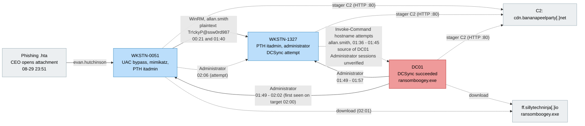

# Investigation Writeup: TryHackMe Boogeyman 3

## Objective
- To analyze logs and assess the impact of the compromise

---

### Initial information
- From what we were given, the CEO of the organization opened the attachment from a suspicious email and reported it to the security team, and the security team presumed that an incident had occurred.

**My notes:** this investigation involved a lot of back and forth analysis of logs between workstations, so to make this writeup structured and easier to read and understand, I am writing it in **phases** with the workstation names mentioned. I tried to make it more readable and chronological to show how the attacker moved across the environment.

--- 

## Analyzing logs on WKSTN-0051 (Phase 1)

- The first step would be to search for any suspicious process creation on the CEO workstation.

### Analyzing process spawned by malicious document
- Searching with the attachment name (`ProjectFinancialSummary_Q3.pdf`) and filtering process creation events (`event.code = 1`) related to the attachment.


- The first one, with parent process `explorer.exe`, is the process that opened the attachment. It spawned the process `mshta.exe` (`pid=6392`), and in the command line we can see the attachment is not a PDF, it is a double extension file (`.pdf.hta`). `mshta.exe` is a LOL binary, it is used by attackers to fetch remote content or to execute VBScript from an HTA.
- Then `mshta.exe` (`pid=6392`) spawned the child process `xcopy.exe` (`pid=3832`), which copied the `review.dat` file from `D:\review.dat` to `C:\Users\EVAN~1.HUT\AppData\Local\Temp\review.dat`.
- Then `mshta.exe` (`pid=6392`) spawned a second child process, `rundll32.exe` (`pid=3680`). It is a legitimate Windows process that loads and executes `.dll` files, but here the file extension is not `.dll`, it is `.dat`, which is an anomaly. This `rundll32.exe` process loads and executes `review.dat` from `D:\review.dat`.


- Then `mshta.exe` (`pid=6392`) spawned a third child process, `powershell.exe` (`pid=6204`), which created a scheduled task named `Review`. In this task `rundll32.exe` executes `\AppData\Local\Temp\review.dat` daily at `06:00`, consistent with persistence.

- Now let's filter for processes created by process `3680` to see what this process spawned.


- This process spawned itself again with process id `4672`. It is known malware behavior where loaders re-execute themselves to get a fresh process, to run in a different session or at a different integrity level.

### Filtering processes spawned by process id `4672`
- Now filtering for processes spawned by the re-executed process.


- There are a total of 8 processes spawned by process id `4672`.
- The first 5 are discovery commands: `whoami /all`, `net.exe users`, `net.exe localgroup administrators`, and `whoami /groups` which ran twice.

- Then it spawned `fodhelper.exe` twice, with process ids `5308` and `5180`. `fodhelper.exe` is a legitimate Windows process that handles optional Windows features from Settings. It runs with auto-elevation, meaning it gets high integrity without a UAC prompt.
  - That auto-elevation is why attackers abuse it: it is a classic UAC bypass (MITRE T1548.002). When it starts, it checks the registry key `HKCU\Software\Classes\ms-settings\Shell\Open\command`. An attacker writes their own command into that key (no admin needed, since HKCU is user-writable), then launches `fodhelper.exe`. Windows elevates it and it runs the attacker's command at high integrity, with no prompt.

- After around 106 minutes (Aug 30, 01:40:37), it attempted to execute a PowerShell command (`pid=2260`). It tried to remotely execute an encoded PowerShell command using `Invoke-Command` on `WKSTN-1327` as username `allan.smith` with a plaintext password. `Invoke-Command` uses Windows Remote Management to execute commands remotely. Here it is spawned by a suspicious process, and the plaintext password makes it more suspicious as it is consistent with lateral movement. We do not know right now whether it failed or succeeded, so we need to look at the logs on endpoint `WKSTN-1327` to verify it.


- **Decoding the PowerShell encoded command**
- On CyberChef, we can decode it by first using `From Base64` and then `Decode text` with the encoding `UTF-16LE`.


- The decoded command builds a WebClient with a handcrafted fake user agent. It Base64-decodes the C2 URL, sets the request path `/admin/get.php`, and uses the machine's default proxy and credentials. The cookie header could be used to identify the session. It decrypts what it receives and executes it using `IEX`.
- Let's decode the URL string on CyberChef.


  - The domain is `hxxp://cdn.bananapeelparty[.]net:80`, so the full request URL is `hxxp://cdn.bananapeelparty[.]net:80/admin/get.php`.

### Looking for registry changes before process `fodhelper.exe`
- Let's check the first instance of `fodhelper.exe` with pid `5308`.


- It did not spawn any child processes, so now checking the other instance of `fodhelper.exe`.
- After filtering events with process id `4672` (re-execution) and isolating the events for registry changes, there are two.


- It set values in the `ms-settings\Shell\Open\command` key under the user's own `HKCU\Software\Classes`, which a standard user can write without admin rights.
- The `(Default)` value holds the attacker's command. `fodhelper.exe` is an auto-elevating binary that reads this key at launch, so it ran the command at high integrity with no UAC prompt.
- The command reads a base64 payload from the registry value `Update` (hive: `HKCU`, key: `Software\Microsoft\Windows Update`, value: `Update`) and runs it with `powershell -enc`. The payload is stored in the registry, not on the command line.
- Thus, `fodhelper.exe` (`pid=5180`) ran this command, which reads the registry value and runs it.

### Analyzing process spawned by `fodhelper.exe` process
- By finding out what `fodhelper.exe` spawned, we can also find out what the encoded PowerShell command in the registry actually was.
- First, filtering events with process id `5180`.


- This executes the PowerShell command stored in the registry, and this PowerShell command executes an encoded command. By looking at the child process spawned by it, we can know what the actual encoded command was.
- The process spawned by `7116` has process id `6160`.


- The decoded payload is also a WebClient stager, but it requests the path `/news.php` and has additional code before the WebClient part that appears to tamper with AMSI and ETW (not analyzed in depth, see Limitations).
- So now it is the point where the machine is contacting the attacker's C2 server and executing commands received from the C2 server.

### Analyzing process spawned by process id `6160`
- Filter for events spawned by process id `6160` (by that PowerShell loader).


- `whoami /all` was the first action after the agent started, 29 seconds after the UAC bypass. It confirms the privileges the agent obtained through `fodhelper.exe`. Then `Get-DomainComputer`, `Get-Domain` and `Get-DomainUser`.
- PowerView (PowerSploit's `Recon/PowerView.ps1`) was fetched with `Invoke-WebRequest` and executed with `iex`, so it was loaded in memory and never written to disk.
- The goal was to map the Active Directory environment (hosts, domain and users) to pick targets for lateral movement.


- Then it fetched `mimikatz` using `Invoke-WebRequest` and saved the file as `mimi.zip` with URI `https://github.com/gentilkiwi/mimikatz/releases/download/2.2.0-20220919/mimikatz_trunk.zip`.
  - Mimikatz is a Windows post-exploitation tool that is used to extract credentials, abuse credentials and for Active Directory attacks.

- Then after 18 seconds it extracted the downloaded `mimi.zip` file, which it fetched earlier using the `Invoke-WebRequest` command.

- Then mimikatz executed `privilege::debug sekurlsa::logonpasswords exit`, which means it attempted to read credentials from memory (`lsass.exe` process). It enables SeDebugPrivilege and needs high integrity, which ties back to why the UAC bypass was needed.
- After around 131 seconds, it executed `sekurlsa::pth /user:itadmin /domain:QUICKLOGISTICS /ntlm:F84769D250EB95EB2D7D8B4A1C5613F2 /run:powershell.exe" exit`. This command performs a `Pass-the-Hash` (PTH) attack (in a nutshell, pass-the-hash is an Active Directory attack in which stolen hashes are used to perform authentication). Here the user is `itadmin` and the NTLM hash is `F84769D250EB95EB2D7D8B4A1C5613F2`, and after performing the attack it spawned a new PowerShell session. The process id of this command is `1892`.
- Filter for processes with parent pid `1892` to check the result of the attack.


- Here we can see that it spawned a child process, `powershell.exe`, with pid `5972`. This confirms the PTH command executed, but the success of the attack is unconfirmed.


- After the PTH, PowerView was fetched again with `Invoke-WebRequest` and executed with `iex`.
- This time the discovery commands were:
  - `Invoke-ShareFinder`: it is used to find network shares that domain users or computers may be able to access (for example SMB shares, accessible shares, etc).
  - `ls FileSystem::\\WKSTN-1327.quicklogistics.org\ITFiles`: accesses the directory `\\WKSTN-1327.quicklogistics.org\ITFiles` on `WKSTN-1327`.
  - `cat FileSystem::\\WKSTN-1327.quicklogistics.org\ITFiles\IT_Automation.ps1`: reads the content of the file `IT_Automation.ps1`.

- Around 30 seconds after reading `IT_Automation.ps1`, at `00:20:23`, it attempted to remotely execute `whoami` on `WKSTN-1327` using `Invoke-Command` (which uses Windows Remote Management) with the credentials username `allan.smith` and password `Tr!ckyP@ssw0rd987`. The time correlation between the file read and this attempt suggests that `IT_Automation.ps1` may contain this credential in plaintext.


- It again attempted to remotely run `whoami` using `Invoke-Command` on `WKSTN-1327` at `00:20:56`.


- Then it remotely executed an encoded PowerShell command (`pid=4976`, Aug 30, 00:21:52) using `Invoke-Command` with the plaintext credential of `allan.smith`. Upon decoding this command, it also builds a WebClient that sends an HTTP request with a handcrafted fake user agent to the path `/admin/get.php` on the same server, `cdn.bananapeelparty[.]net:80`. It receives data from the server, decrypts it and executes it using `iex`.

### Before moving to WKSTN-1327, let's verify LSASS access
- When I filter for event code `10` (process access):


- There is no event code 10 (Sysmon ProcessAccess) in the index, so LSASS access by mimikatz cannot be confirmed directly from the logs. It is likely that ProcessAccess is not configured in the Sysmon config or not forwarded. Suspected, the config was not available.
- However, the NTLM hash of `itadmin` appears in the `sekurlsa::pth` command line, around 131 seconds after `sekurlsa::logonpasswords`, which shows the attacker had the hash.

---

## Analyzing logs on WKSTN-1327 (Phase 2)
- Checking logon events (Event ID `4624`) on `WKSTN-1327` around the time of the remote command execution.


- The first successful logon event on `WKSTN-1327` is logged at `00:20:57`, just after the second attempt of remote command execution from `WKSTN-0051`, with LogonId `0x644c18`. It is logon type `3` (network) using `Kerberos` for the user `allan.smith`.
- There is also a logon event at `00:21:53` with LogonId `0x64d464`, which is less than a second after the malicious encoded command was executed remotely.

- The attacker has now laterally moved to `WKSTN-1327` using **Windows Remote Management**.

### Analyzing Process Creation Events (Event ID `1`)


- The first process is `wsmprovhost.exe`, spawned by parent process `svchost.exe`. `wsmprovhost.exe` is a Windows system binary (in `C:\Windows\System32`) called the WSMan Provider Host. It is the process that actually runs a remote PowerShell session on the target machine. Its job is to host the PowerShell engine for the remote session (`Invoke-Command` in this case) and execute the command the remote client sends.
- The first child process spawned by `wsmprovhost.exe` is `whoami.exe` at `00:20:59`, three seconds after the second attempt to execute `whoami` from `WKSTN-0051` using `Invoke-Command`, with LogonId `0x644c18`, which matches the first logon event. By time correlation we can say the first attempt to run `whoami` may have failed and the second attempt was a success.
- The second `wsmprovhost.exe` (`pid=6788`) executed that malicious encoded command through `powershell.exe` at `00:21:53`, less than a second after the attempt from `WKSTN-0051`, with LogonId `0x64d464`, which matches the logon event at `00:21:53`. Note the pid of the PowerShell process: `6708`.

### Analyzing process spawned by parent process `6708` (encoded command execution)
- After around 23 seconds, process `6708` spawned a child process, `cmd.exe` (`pid=5128`), which executed `hostname`.


- After 6 seconds it executed `whoami /all` in `cmd.exe`.
- There are no process creation events between `00:22:22` and `01:28:22`, for 66 minutes. The first event after the gap is `more.com` (`01:28:22`), which was not analyzed (see Limitations).
- At `01:29:09` it spawned a child process that downloaded mimikatz `https://github.com/gentilkiwi/mimikatz/releases/download/2.2.0-20220919/mimikatz_trunk.zip` as `mimi.zip` using `Invoke-WebRequest`.
- After 30 seconds of downloading `mimikatz`, it extracted it.


- Then after extracting mimikatz, it performed `Pass-the-Hash` on the user account `itadmin` with the stolen NTLM hash `F84769D250EB95EB2D7D8B4A1C5613F2`, which it stole from `WKSTN-0051` in Phase 1, and ran PowerShell.
- After 26 seconds from the `Pass-the-Hash` attempt on `itadmin`, it executed `privilege::debug sekurlsa::logonpasswords exit`, which means it attempted to read credentials from memory (`lsass.exe`).
- After 48 seconds of reading memory, it again attempted `Pass-the-Hash` on the account `Administrator` with NTLM hash `00f80f2538dcb54e7adc715c0e7091ec` and ran PowerShell.


- After 115 seconds from the `Pass-the-Hash` attempt on the account `Administrator`, it ran `Invoke-Comand -ScriptBlock {hostname} -ComputerName DC01.quicklogistics.org`. The attacker's goal was to execute `hostname` on `DC01` remotely using `Invoke-Command`, but because of the typo in `Invoke-Comand` it failed (Suspected).

- Then it again aimed to execute `hostname` on `DC01` remotely, `Invoke-Comand -ScriptBlock {hostname}`, but this time it forgot to add the computer name.

- Then it tried to access the shared resource on `DC01`, path: `\\DC01.quicklogistics.org\c$`.

- After 54 seconds of accessing the shared resource, it attempted `DCSync` to pull credentials of the target account `administrator`.

- After 40 seconds of the `DCSync` attempt, it launched a `Pass-the-Hash` attack. The account is `Administrator` and the NTLM hash is `00f80f2538dcb54e7adc715c0e7091ec`. This hash is the same as the one it used earlier for `Pass-the-Hash` after reading credentials from memory.

- Then it attempted to remotely execute `hostname` on `DC01` using `Invoke-Command` twice, at `01:36:40` and `01:37:01`.

- **Validating PTH Attempt**


- There are a total of five logon events (Event ID `4624`) for `Pass-the-Hash` attempts. Here the logon type is `9`, the logon process name is `seclogo` and the authentication package name is `Negotiate`. This combination is a strong indicator of PTH, and each one matches a `sekurlsa::pth` command run by the attacker.
- The first matches our timeline for `itadmin`, attempted at `01:30:25`.
- The second matches our timeline for `Administrator`, attempted at `01:31:39`.
- The third matches our timeline for `Administrator`, attempted at `01:35:54`.

- The remaining two are described later in this phase:

  - The fourth matches our timeline for `Administrator`, attempted at `01:41:34`.
  - The fifth matches our timeline for `Administrator`, attempted at `01:43:57`.


- After around 217 seconds from the last attempt to remotely execute a command on `DC01`, at `01:40:38` `svchost.exe` spawned a child process, `wsmprovhost.exe` (`pid=2780`), initializing a remote session on the current workstation `WKSTN-1327`.
- Then `wsmprovhost.exe` executed the malicious encoded command through `powershell.exe` (`pid=6320`).


- This encoded command is the same as the one executed from `WKSTN-0051` and analyzed earlier in Phase 1: it builds a WebClient and executes the received commands using `IEX`. So the attacker again moved laterally from `WKSTN-0051` to the current workstation (`WKSTN-1327`).

### Process spawned by `6320` (malicious PowerShell payload)

- It performed `Pass-the-Hash` with the user account `Administrator` and NTLM hash `00f80f2538dcb54e7adc715c0e7091ec`. The matching logon event is in the **Validating PTH Attempt** section above.

- Then it ran `schtasks.exe` to create a scheduled task: `/Create /F /RU system /SC ONIDLE /I 2 /TN Updater /TR "C:\Windows\System32\WindowsPowerShell\v1.0\powershell.exe -NonI -W hidden -c \"IEX ([Text.Encoding]::UNICODE.GetString([Convert]::FromBase64String((gp HKLM:\Software\Microsoft\Network debug).debug)))\""`. It decodes the value named `debug` (hive: `HKLM`, key: `Software\Microsoft\Network`, value: `debug`) and executes it in PowerShell, consistent with persistence.

- Then at `01:43:36` it attempted to execute `hostname` on `DC01` using `Invoke-Command`.


- After 9 seconds it tried to execute `hostname` using `Invoke-Command`. No computer name was given, so it ran locally on `WKSTN-1327` (`HOSTNAME.EXE` was spawned).

- At `01:43:57` it again made a `Pass-the-Hash` attempt, account `Administrator`. It also has a matching logon event, which was analyzed in the **Validating PTH Attempt** section above.

- At `01:45:12` it again attempted to remotely execute `hostname` on `DC01`.

---

## Analyzing logs on DC01 (Phase 3)

- Moving to `DC01` to verify the remote command execution.


- At `01:45:02` parent process `svchost.exe` spawned a child process `wsmprovhost.exe` with process id `6644`, then `wsmprovhost.exe` spawned the child process `hostname.exe`. Near this time there is no attempt to execute a remote command on `DC01`; the last attempt was around 86 seconds before (`01:43:36`). Also, these processes ran as `Administrator`, while on `WKSTN-1327` the remote command execution attempts are from the account `allan.smith`.

- After 17 seconds, at `01:45:19`, `hostname.exe` was spawned by a different instance of parent `wsmprovhost.exe` (`pid=7152`), and the username here is `Administrator`. At `01:45:12` in Phase 2 there was an attempt from `WKSTN-1327` to execute a remote command on `DC01`, and that attempt was also from the account `allan.smith`.

- At `01:45:41` parent `wsmprovhost.exe` (`pid=5292`) spawned a child process `powershell.exe` that ran a suspicious encoded command, the process id of `powershell.exe` is `4008`.


- The decoded command is the same stager as the one decoded in Phase 1 (`process_id_2260_decoding_enc.png`): same C2 URL (`cdn.bananapeelparty[.]net:80`), same request path `/admin/get.php`, and the same cookie value `rlkHVXWbb=13cfco9rUXx0i4J3xTu682JFiX0=`. It decrypts what it receives and executes it using `IEX`.

- All remotely executed `hostname` commands and the encoded command ran on `DC01` as `Administrator`. The nearby attempts from `WKSTN-1327` in Phase 2 ran as `allan.smith`, so they do not match these sessions. No process creation events (Event ID `1`) for `Administrator` were found on `WKSTN-1327` or `WKSTN-0051` before the sessions from `DC01` started appearing there (`01:49:11` and `02:00:57`). They were possibly sent from a different workstation, but the source is unverified.

### Analyzing process spawned by `4008` (malicious encoded command)

- At `01:46:18` it downloaded `mimikatz` as `mimi.zip` using `Invoke-WebRequest`.
- After 14 seconds of downloading it, it extracted `mimi.zip`.


- At `01:47:34` it ran `net.exe localgroup administrators`.
- At `01:47:57` it ran `lsadump::dcsync /domain:quicklogistics.org /user:backupda" exit`, which means an attempt of `DCSync` targeting the username `backupda` (validated in the **Validating DCSync Attempts** section).
- At `01:48:04` it again attempted `DCSync`, but this time the target username is `administrator`.
- After 57 seconds, at `01:49:01`, it attempted to remotely execute `hostname` on `WKSTN-1327` using `Invoke-Command`.


- At `01:49:11`, it again attempted to remotely execute `hostname` on `WKSTN-1327` using `Invoke-Command`.
- At `01:49:19`, it attempted to remotely execute `hostname` on `WKSTN-0051` using `Invoke-Command`.
- At `01:50:00`, it again attempted to remotely execute `hostname` on `WKSTN-0051` using `Invoke-Command`.
- At `01:50:37`, it one more time attempted to remotely execute `hostname` on `WKSTN-0051` using `Invoke-Command`.


- At `01:53:13` it downloaded the file `ransomboogey.exe` using `Invoke-WebRequest` from the URL `hxxp[:]//ff.sillytechninja[.]io/ransomboogey.exe`.
- Then after 20 seconds, it ran the downloaded file `ransomboogey.exe`, the child process pid is `5572`.
- At `01:54:11`, it attempted to remotely execute `hostname` on `WKSTN-1327` using `Invoke-Command`.
- At `01:54:24`, it attempted to remotely execute `hostname` on `WKSTN-0051` using `Invoke-Command`.
- At `01:54:24`, it attempted to remotely execute `hostname` on `WKSTN-0051` using `Invoke-Command`.


- At `01:56:05`, using `Invoke-Command`, it attempted to remotely download the same file `ransomboogey.exe` from the URL `hxxp[:]//ff.sillytechninja[.]io/ransomboogey.exe` using `Invoke-WebRequest` and run it on `WKSTN-1327` (download and run attempt).
- At `01:56:40`, it again attempted the previous command remotely on `WKSTN-1327`, but this time it saved the file at the path `C:\Users\itadmin\ransomboogey.exe` and ran it from there (download and run attempt).
- At `01:57:53`, it attempted to remotely execute the file `ransomboogey.exe` from `C:\Users\itadmin\ransomboogey.exe`, which it downloaded earlier, on `WKSTN-1327`.
- At `01:59:36`, it attempted to remotely download the file `ransomboogey.exe` from the URL `hxxp[:]//ff.sillytechninja[.]io/ransomboogey.exe` on `WKSTN-0051` and save it to the path `C:\Users\itadmin\ransomboogey.exe`.


- At `02:00:58`, it attempted to remotely execute `hostname` on `WKSTN-0051` using `Invoke-Command`.
- At `02:01:14`, it attempted to remotely download the file `ransomboogey.exe` from the URL `hxxp[:]//ff.sillytechninja[.]io/ransomboogey.exe` on `WKSTN-0051` and save it to the path `C:\Users\evan.hutchinson\ransomboogey.exe`.
- At `02:02:09`, it attempted to run an encoded command on `WKSTN-0051` using `Invoke-Command`.


- The decoded command matches the earlier stagers again: same C2 URL, path `/admin/get.php` and cookie value.

### Analyzing process `5572` (the ransomboogey.exe execution)

- Analyzing the process `ransomboogey.exe` (`pid=5572`), which ran at `01:53:33`.


- The process spawned file creation events (Event ID `11`). In all of them, the files have the `.boogey` extension, which is not a known legitimate extension. The targeted files are in `C:\Users\Administrator\Downloads` and its subdirectories. File creation with an unknown extension is consistent with ransomware, and this binary is unknown and was downloaded by the attacker.

- At `01:53:34` file created with `.boogey` extension, file path: `C:\Users\Administrator\Downloads\ChromeSetup.exe.boogey`
- At `01:53:35` file created with `.boogey` extension, file path: `C:\Users\Administrator\Downloads\officedeploymenttool_16626-20148.exe.boogey`
- At `01:53:35` file created with `.boogey` extension, file path: `C:\Users\Administrator\Downloads\sysmon-config.xml.boogey`
- At `01:53:35` file created with `.boogey` extension, file path: `C:\Users\Administrator\Downloads\Sysmon.zip.boogey`
- At `01:53:36` file created with `.boogey` extension, file path: `C:\Users\Administrator\Downloads\winlogbeat-7.17.6-windows-x86_64.msi.boogey`
- At `01:53:37` file created with `.boogey` extension, file path: `C:\Users\Administrator\Downloads\Sysmon\Eula.txt.boogey`
- At `01:53:37` file created with `.boogey` extension, file path: `C:\Users\Administrator\Downloads\Sysmon\Sysmon.exe.boogey`
- At `01:53:38` file created with `.boogey` extension, file path: `C:\Users\Administrator\Downloads\Sysmon\Sysmon64.exe.boogey`
- At `01:53:38` file created with `.boogey` extension, file path: `C:\Users\Administrator\Downloads\Sysmon\Sysmon64a.exe.boogey`
- At `01:53:38` process terminated (Event ID `5`)

### Validating DCSync Attempts


- The first DCSync attempt in Phase 3 was observed at `01:47:57.809` (the mimikatz command), and Event ID `4662` records with `event.outcome` `success` (an operation was performed on an object) follow at `01:47:57.875`. The `AccessMask` is `0x100`, which is the Control Access right, required to invoke DS-Replication-Get-Changes-All. The account name is `Administrator`. DCSync is normally initiated only between domain controllers, and here the account is not a machine account but a known compromised account, so this is a strong indicator of malicious activity. The `SubjectLogonId` is `0x87f26f2`, which matches the LogonId of the process that ran the mimikatz command.
  - This event is logged 4 times at the same time (`01:47:57.875`). This does not necessarily mean different attempts, and the GUIDs are as follows:
    - `1131f6ad-9c07-11d1-f79f-00c04fc2dcd2` is DS-Replication-Get-Changes-All
    - `1131f6aa-9c07-11d1-f79f-00c04fc2dcd2` is DS-Replication-Get-Changes (recorded two times)
    - `89e95b76-444d-4c62-991a-0facbeda640c` is DS-Replication-Get-Changes-In-Filtered-Set

- The second DCSync attempt in Phase 3 was observed at `01:48:04.117`, for the username `administrator` (the domain `administrator` account, after the earlier discovery command `net.exe localgroup administrators`). There are 4 records of Event ID `4662` with outcome `success` at `01:48:04.155`, initiated by the username `Administrator` (non-machine account), `AccessMask` `0x100` and the same `SubjectLogonId` `0x87f26f2` as in the first attempt.
  - This event is also logged 4 times at the same time (`01:48:04.155`). This does not necessarily mean different attempts, and the GUIDs are the same as above.

- There are also two earlier `4662` events from the machine account `DC01$` (LogonId `0xdcfba`), before any attacker activity on `DC01`. These are expected for a domain controller, so they are noise.

- As `event.outcome` was `success` for both and the events match the mimikatz commands by time and LogonId, both DCSync commands in Phase 3 succeeded: the DC processed the replication requests. The mimikatz output (the credentials returned) is not visible in the logs, so the targeted accounts (`backupda` and `administrator`) should be treated as compromised. No later use of `backupda` is visible in the logs, and `Administrator` was already in use before the DCSync.

- I also filtered Event ID `4662` overall, without any host or user filter. There are no `4662` events for the Phase 2 DCSync attempt from `WKSTN-1327` (`01:35:15`, user `allan.smith`). `4662` events were logged for the Phase 3 attempts, so the auditing was working, and the missing events suggest the Phase 2 attempt most likely failed (Suspected).

### Moving to WKSTN-0051

- Filtering process creation events (Event ID `1`) on `WKSTN-0051` for the user `Administrator`. The `SYSTEM` and `LOCAL SERVICE` processes are excluded as noise.
- There is also a logon event (Event ID `4624`) for `administrator`, logon type `10` (RemoteInteractive), LogonId `0x90cea`, from the source IP `10.4.29.242`. `Restricted Admin Mode` is `No`, so it is not a pass-the-hash style RDP logon, which requires Restricted Admin Mode. The process creation events under this LogonId did not contain any suspicious activity, so I treated it as noise (my assessment). The source IP could not be identified, as there is no asset inventory available.


- The first event is at `02:00:57.865`, parent `svchost.exe` spawned a child process `wsmprovhost.exe` (`pid=6948`), then `wsmprovhost.exe` executed `hostname.exe`. This matches the `hostname` command from `DC01` at `02:00:58.090`.

- Then at `02:01:14` `svchost.exe` spawned another instance of `wsmprovhost.exe`, and this time `wsmprovhost.exe` did not spawn a child process. This matches the `ransomboogey.exe` download from `DC01` at `02:01:14.244`, validated in the next section.

- At `02:02:09.164` `svchost.exe` spawned `wsmprovhost.exe`, and this instance of `wsmprovhost.exe` executed the malicious encoded command. On `DC01` the remote attempt to execute this encoded command was at `02:02:09.235`, so the execution on `WKSTN-0051` is about 70 milliseconds earlier. This is possibly due to a small time difference between the clocks of the two hosts.

- Then the encoded command spawned two processes at `02:06:09` and `02:06:25`. Both are attempts to remotely execute the malicious encoded command, on `WKSTN-0051` and `WKSTN-1327` respectively. The current workstation is `WKSTN-0051`, so the first attempt could be an attacker typo or mistake (my assessment).

- There are no more process creation events on `WKSTN-0051`.
- There are no process creation events for the earlier remote `hostname` attempts (`01:49:19`, `01:50:00`, `01:50:37`, `01:54:24`) and for the `01:59:36` `ransomboogey.exe` download.

### Validating the ransomboogey.exe download on WKSTN-0051


- Filtering for the `wsmprovhost.exe` instance (`pid=3012`) from `02:01:14`, which did not spawn a child process, shows the following events:
  - `02:01:14.001`: DNS query (Event ID `22`) for `ff.sillytechninja[.]io`, the domain the file was downloaded from.
  - `02:01:14.201`: file creation (Event ID `11`) of `__PSScriptPolicyTest_yy2ygmfd.fyp.ps1` in `C:\Users\administrator\AppData\Local\Temp`, which is a normal artifact created when a PowerShell session starts, not part of the attack.
  - `02:01:14.969`: file creation (Event ID `11`) of `ransomboogey.exe` at `C:\Users\evan.hutchinson\ransomboogey.exe`.
- This shows the download command from `DC01` worked, and `ransomboogey.exe` was created in the user profile of `evan.hutchinson` on `WKSTN-0051`.

### Moving to WKSTN-1327


- At `01:49:11` parent `svchost.exe` spawned a child process `wsmprovhost.exe`, and the same `wsmprovhost.exe` executed `hostname.exe` at `01:49:12`.
- At `01:54:11` parent `svchost.exe` spawned a child process `wsmprovhost.exe`, and the same `wsmprovhost.exe` executed `hostname.exe` at `01:54:11`.
- At `01:56:05` `svchost.exe` spawned a child process `wsmprovhost.exe`, and the same `wsmprovhost.exe` started `ransomboogey.exe` at `01:56:06`, path: `C:\Users\administrator\Documents\ransomboogey.exe`, pid: `6644`.
- At `01:56:40` another `wsmprovhost.exe` was spawned, and `ransomboogey.exe` was started at `01:56:42`, but this time the path is different: `C:\Users\itadmin\ransomboogey.exe`, pid: `5312`.
- At `01:57:53` another `wsmprovhost.exe` was spawned, and `ransomboogey.exe` was started at `01:57:54` from the path `C:\Users\itadmin\ransomboogey.exe`, pid: `6192`.

### Validating ransomboogey.exe execution on WKSTN-1327


- After filtering for the specific process pids, in all three attempts to execute `ransomboogey.exe` the process terminated (Event ID `5`, process terminated) within a second after execution, and there are no file creation events (Event ID `11`) for these processes, unlike on `DC01`.

---

## Timeline of Events (UTC)

`EID` = Event ID. EID 1, 5, 11, 13 and 22 are Sysmon events. EID 4624 and 4662 are Windows Security events.

| Time (2023) | Host | User | Event | Evidence |
|---|---|---|---|---|
| 08-29 23:51:15 | WKSTN-0051 | evan.hutchinson | `explorer.exe` opens `ProjectFinancialSummary_Q3.pdf.hta` (double extension) and spawns `mshta.exe` | EID 1, pid 6392 |
| 08-29 23:51:16 | WKSTN-0051 | evan.hutchinson | `mshta.exe` copies `D:\review.dat` to Temp (`xcopy.exe`), loads it with `rundll32.exe`, and creates scheduled task `Review` (daily 06:00) | EID 1, pids 3832, 3680, 6204 |
| 08-29 23:51:17 | WKSTN-0051 | evan.hutchinson | `rundll32.exe` re-executes itself | EID 1, pid 4672 |
| 08-29 23:53:47 to 23:54:48 | WKSTN-0051 | evan.hutchinson | Discovery: `whoami /all`, `net users`, `net localgroup administrators`, `whoami /groups` | EID 1, parent 4672 |
| 08-29 23:54:48 | WKSTN-0051 | evan.hutchinson | UAC bypass: values set under `ms-settings\Shell\Open\command`, then `fodhelper.exe` launched twice | EID 13, EID 1, pids 5308, 5180 |
| 08-29 23:54:50 | WKSTN-0051 | evan.hutchinson | Encoded payload read from the registry runs as a C2 stager (`cdn.bananapeelparty[.]net:80`) | EID 1, pids 7116, 6160 |
| 08-29 23:55:17 to 08-30 00:09:23 | WKSTN-0051 | evan.hutchinson | `whoami /all`, then PowerView loaded in memory: `Get-DomainComputer`, `Get-Domain`, `Get-DomainUser` | EID 1, parent 6160 |
| 08-30 00:09:57 | WKSTN-0051 | evan.hutchinson | Mimikatz downloaded (`mimi.zip`) and extracted at 00:10:15 | EID 1 |
| 08-30 00:11:26 | WKSTN-0051 | evan.hutchinson | `sekurlsa::logonpasswords` (LSASS access not confirmed, no EID 10) | EID 1, pid 4948 |
| 08-30 00:13:37 | WKSTN-0051 | evan.hutchinson | `sekurlsa::pth /user:itadmin` with hash `F84769D250EB95EB2D7D8B4A1C5613F2`, spawns `powershell.exe`; success unconfirmed | EID 1, pids 1892, 5972 |
| 08-30 00:14:36 to 00:19:52 | WKSTN-0051 | evan.hutchinson | `Invoke-ShareFinder`, then `ls` and `cat` of `\\WKSTN-1327.quicklogistics.org\ITFiles\IT_Automation.ps1` | EID 1, parent 6160 |
| 08-30 00:20:23 to 00:21:52 | WKSTN-0051 to WKSTN-1327 | evan.hutchinson | `Invoke-Command` with `allan.smith` plaintext password: `whoami` (00:20:23, 00:20:56), then the encoded C2 stager (00:21:52) | EID 1, pids 7952, 6848, 4976 |
| 08-30 00:20:57 | WKSTN-1327 | allan.smith | WinRM logon (type 3, Kerberos, LogonId `0x644c18`), `wsmprovhost.exe` runs `whoami.exe` | EID 4624, EID 1, pids 4892, 5076 |
| 08-30 00:21:53 | WKSTN-1327 | allan.smith | Logon `0x64d464`, `wsmprovhost.exe` runs the encoded C2 stager (`powershell.exe` pid 6708) | EID 4624, EID 1, pids 6788, 6708 |
| 08-30 00:22:15 | WKSTN-1327 | allan.smith | `hostname` and `whoami /all` via `cmd.exe`, then no process creation until 01:28:22 (66 minutes) | EID 1, parent 6708 |
| 08-30 01:29:09 | WKSTN-1327 | allan.smith | Mimikatz downloaded and extracted (01:29:39) | EID 1 |
| 08-30 01:30:25 to 01:31:39 | WKSTN-1327 | allan.smith | PTH `itadmin` (01:30:25), `logonpasswords` (01:30:51), PTH `Administrator` with hash `00f80f2538dcb54e7adc715c0e7091ec` (01:31:39); each PTH has a 4624 type 9 (`seclogo`) | EID 1, EID 4624, pids 2056, 6736, 6236 |
| 08-30 01:33:34 to 01:34:20 | WKSTN-1327 | allan.smith | `Invoke-Comand` (typo, suspected failed) attempts against DC01, then `ls \\DC01.quicklogistics.org\c$` | EID 1, pids 6268, 508, 1248 |
| 08-30 01:35:15 | WKSTN-1327 | allan.smith | DCSync attempt (`lsadump::dcsync /user:administrator`), no EID 4662 on DC01 (suspected failed) | EID 1, pid 6544 |
| 08-30 01:35:54 | WKSTN-1327 | allan.smith | PTH `Administrator` again; `Invoke-Command hostname -ComputerName DC01` at 01:36:40 and 01:37:01 | EID 1, EID 4624, pids 7072, 7076, 4336 |
| 08-30 01:40:37 | WKSTN-0051 to WKSTN-1327 | evan.hutchinson | Second `Invoke-Command` with the `allan.smith` password runs the encoded C2 stager | EID 1, pid 2260 (parent 4672) |
| 08-30 01:40:38 | WKSTN-1327 | allan.smith | Logon `0x81f1da`, `wsmprovhost.exe` runs the encoded C2 stager (`powershell.exe` pid 6320) | EID 1, pids 2780, 6320 |
| 08-30 01:41:34 | WKSTN-1327 | allan.smith | PTH `Administrator` (session `0x81f1da`); 4624 type 9 | EID 1, EID 4624, pid 5756 |
| 08-30 01:42:47 | WKSTN-1327 | allan.smith | `schtasks /Create /RU system /SC ONIDLE /TN Updater` runs a payload stored in `HKLM:\Software\Microsoft\Network` value `debug` (persistence) | EID 1, pid 4276 |
| 08-30 01:43:36 to 01:43:57 | WKSTN-1327 | allan.smith | `Invoke-Command hostname -ComputerName DC01` (01:43:36); `Invoke-Command hostname` without a computer name runs locally (01:43:45); PTH `Administrator` (01:43:57, 4624 type 9) | EID 1, EID 4624, pids 4464, 3100, 6604, 5096 |
| 08-30 01:45:02 | DC01 | Administrator | `wsmprovhost.exe` runs `hostname.exe` as `Administrator`; source unverified | EID 1, pid 6644 |
| 08-30 01:45:12 | WKSTN-1327 to DC01 | allan.smith | `Invoke-Command hostname -ComputerName DC01` | EID 1, pid 5156 |
| 08-30 01:45:19 | DC01 | Administrator | `wsmprovhost.exe` runs `hostname.exe` as `Administrator`; source unverified | EID 1, pid 7152 |
| 08-30 01:45:41 | DC01 | Administrator | `wsmprovhost.exe` runs the encoded C2 stager | EID 1, pids 5292, 4008 |
| 08-30 01:46:18 | DC01 | Administrator | Mimikatz downloaded and extracted (01:46:32), `net localgroup administrators` (01:47:34) | EID 1, parent 4008 |
| 08-30 01:47:57 | DC01 | Administrator | DCSync for `backupda` succeeded: 4 x EID 4662 (success, `AccessMask 0x100`, replication GUIDs), LogonId `0x87f26f2` | EID 1, EID 4662 |
| 08-30 01:48:04 | DC01 | Administrator | DCSync for `administrator` succeeded: 4 x EID 4662, same LogonId | EID 1, EID 4662 |
| 08-30 01:49:01 to 01:50:37 | DC01 to WKSTN-1327 and WKSTN-0051 | Administrator | `Invoke-Command hostname` attempts: WKSTN-1327 (01:49:01, 01:49:11), WKSTN-0051 (01:49:19, 01:50:00, 01:50:37) | EID 1, parent 4008 |
| 08-30 01:53:13 | DC01 | Administrator | `ransomboogey.exe` downloaded from `hxxp://ff.sillytechninja[.]io/ransomboogey.exe` and run 20 s later | EID 1, pid 5572 |
| 08-30 01:53:34 to 01:53:38 | DC01 | Administrator | `ransomboogey.exe` creates 9 `.boogey` files in `C:\Users\Administrator\Downloads` (consistent with encryption), then terminates | EID 11, EID 5, pid 5572 |
| 08-30 01:54:11 and 01:54:24 | DC01 to WKSTN-1327 and WKSTN-0051 | Administrator | `Invoke-Command hostname` attempts | EID 1, parent 4008 |
| 08-30 01:56:05 to 01:57:53 | DC01 to WKSTN-1327 | Administrator | Remote download and run of `ransomboogey.exe` (01:56:05, 01:56:40), then run from `C:\Users\itadmin\` (01:57:53) | EID 1, parent 4008 |
| 08-30 01:56:06 to 01:57:54 | WKSTN-1327 | Administrator | `ransomboogey.exe` started 3 times via `wsmprovhost.exe`, terminated within a second each, no file creation events | EID 1, EID 5, pids 6644, 5312, 6192 |
| 08-30 01:59:36 | DC01 to WKSTN-0051 | Administrator | Remote download of `ransomboogey.exe` to `C:\Users\itadmin\` (no process event found on the target) | EID 1 |
| 08-30 02:00:58 | DC01 to WKSTN-0051 | Administrator | `Invoke-Command hostname`; seen on the target at 02:00:57.865 (`wsmprovhost.exe` runs `hostname.exe`) | EID 1, pid 6948 |
| 08-30 02:01:14 | DC01 to WKSTN-0051 | Administrator | Remote download of `ransomboogey.exe` to `C:\Users\evan.hutchinson\`; target shows the DNS query and file creation, no execution | EID 22, EID 11, pid 3012 |
| 08-30 02:02:09 | DC01 to WKSTN-0051 | Administrator | `Invoke-Command` runs the encoded C2 stager on WKSTN-0051 | EID 1, pids 1656, 5004 |
| 08-30 02:06:09 and 02:06:25 | WKSTN-0051 | Administrator | The stager runs encoded command attempts against WKSTN-0051 (itself) and WKSTN-1327 | EID 1, pids 8324, 2340 |

--- 

## Process Tree (Phase 1 only)

```text
LEGEND: [INIT] initial access   [PERSIST] persistence   [UAC] privilege escalation
        [DISC] discovery        [CRED] credential theft  [LAT] lateral movement
        [C2] command and control
        AS: = account the command ran under or authenticated with

WKSTN-0051 (logged-in user: evan.hutchinson)

explorer.exe (2940)
│
└─ mshta.exe (6392)  [INIT] opens ProjectFinancialSummary_Q3.pdf.hta
   │
   ├─ xcopy.exe (3832)  copies D:\review.dat to Temp
   │
   ├─ powershell.exe (6204)  [PERSIST] scheduled task "Review", daily 06:00
   │
   └─ rundll32.exe (3680)  loads review.dat as a DLL
      │
      └─ rundll32.exe (4672)  re-executes itself
         │
         ├─ [DISC] whoami, net users, net localgroup, whoami /groups x2
         │
         ├─ registry: ms-settings\Shell\Open\command hijacked (EID 13)
         │
         ├─ fodhelper.exe (5308)  no child
         │
         ├─ fodhelper.exe (5180)  [UAC] auto-elevated bypass
         │  │
         │  └─ powershell.exe (7116)  reads registry payload, runs it with -enc
         │     │
         │     └─ powershell.exe (6160)  [C2] stager (cdn.bananapeelparty[.]net)
         │        │
         │        ├─ [DISC] whoami /all
         │        │
         │        ├─ [DISC] PowerView: Get-DomainComputer / Get-Domain / Get-DomainUser
         │        │
         │        ├─ [CRED] mimikatz download + extract
         │        │
         │        ├─ [CRED] mimikatz logonpasswords  AS: evan.hutchinson (high integrity inferred from the UAC bypass)
         │        │
         │        ├─ [CRED] mimikatz PTH (1892)  AS: itadmin (hash used, success unconfirmed)
         │        │  │
         │        │  └─ powershell.exe (5972)  PTH shell, success unconfirmed
         │        │
         │        ├─ [DISC] ShareFinder, ls ITFiles, cat IT_Automation.ps1
         │        │
         │        ├─ [LAT] Invoke-Command whoami -> WKSTN-1327 x2 (7952, 6848)
         │        │        AS: allan.smith, plaintext password Tr!ckyP@ssw0rd987
         │        │        (likely read from IT_Automation.ps1)
         │        │
         │        └─ [LAT] Invoke-Command enc stager (4976) -> WKSTN-1327
         │                 AS: allan.smith, plaintext password Tr!ckyP@ssw0rd987
         │
         └─ powershell.exe (2260)  [LAT] Invoke-Command enc stager -> WKSTN-1327
                   AS: allan.smith, plaintext password Tr!ckyP@ssw0rd987
```

- **Why only Phase 1 has a process tree:** Phase 1 is a deep, branching chain, so a tree helps there. In Phases 2 and 3 the stager performs all the activity, so a tree would be one parent with a long list of children, and the timeline table already shows that in order.

--- 

## Attack Path Across Hosts


---

## Conclusion

**Summary**
- This is a confirmed compromise (true positive) of three hosts: `WKSTN-0051`, `WKSTN-1327` and `DC01`. It started on Aug 29 at `23:51` when the CEO opened the malicious `.pdf.hta` attachment, and reached execution of `ransomboogey.exe` on `DC01` on Aug 30 at `01:53`, about 2 hours later.

**What the attacker achieved**
- **Domain credential theft:** DCSync succeeded on DC01 for `backupda` and `administrator` (EID 4662 success events matching the mimikatz commands by time and LogonId). The DC processed the replication requests, so the password data of both accounts should be treated as obtained, even though the mimikatz output is not in the logs. No later use of `backupda` is visible in the logs, and `Administrator` was already in use before the DCSync (PTH at `01:31:39` and the session that ran the DCSync).
- **Persistence on two hosts:** the `Review` scheduled task on WKSTN-0051 and the `Updater` scheduled task (SYSTEM) on WKSTN-1327, which runs a payload stored in the registry (`HKLM:\Software\Microsoft\Network`, value `debug`). Both persist across reboots. They were identified from command lines, not from task creation events.
- **Partial ransomware impact:** `ransomboogey.exe` created 9 `.boogey` files on DC01 and exited. The attacker also downloaded it to WKSTN-0051 and ran it three times on WKSTN-1327, where it terminated within a second without creating files.

**Why the attack worked**
- Beyond the malicious attachment, no exploit was seen in the logs. The attacker used built-in Windows tools (`mshta`, `rundll32`, `fodhelper`, WinRM, PowerShell) and stolen or exposed credentials: the `allan.smith` password and the `itadmin` and `Administrator` hashes.
- One exposed credential (the `allan.smith` password, most likely from `IT_Automation.ps1`) gave access to the second host. Privileged hashes were then used in PTH attempts and `Administrator` sessions appeared on DC01, but the path to DC01 is unverified.
- Credential theft tools ran without being blocked, no alert is visible in the logs, and LSASS access was not logged (no Sysmon EID 10).
- The activity looks hands-on-keyboard rather than automated: typos in `Invoke-Comand`, repeated `hostname` checks, and a 66-minute pause on WKSTN-1327. This is my inference from behavior, not something the logs prove.

**Confidence**
- **High:** initial execution (`.hta`, `mshta`, `rundll32`), UAC bypass, WinRM movement to WKSTN-1327, DCSync on DC01 (success events), and execution of `ransomboogey.exe` on DC01.
- **Medium:** creation of the `Review` and `Updater` scheduled tasks (command lines seen, no task creation events).
- **Lower or unverified:** the `itadmin` PTH result, LSASS access, the source of the `Administrator` sessions on DC01, what the DCSync returned and whether it was used afterwards, whether the files on DC01 were actually encrypted, and the effect of the `ransomboogey.exe` runs on WKSTN-1327.

---

## Limitations

- **Initial access:** reconstructed from process creation events only. The phishing email, the attachment and the contents of the `.hta` and `review.dat` were not analyzed. No process in the logs created `review.dat`. The `D:\` path suggests removable or mounted media, but the source is unknown.
- **Credential theft:** no Sysmon Event ID 10 (ProcessAccess) was present, so LSASS access is inferred from `sekurlsa::logonpasswords` and from the hashes appearing in later `sekurlsa::pth` commands. The type 9 logon events (`seclogo`) show PTH was executed, not that a remote system accepted the hash. The link between `IT_Automation.ps1` and the `allan.smith` password is based on timing only.
- **DCSync:** the 4662 events show it succeeded, but the credentials returned are not in the logs and no later use is visible. `backupda` and `administrator` are treated as compromised, so the exposure is inferred. The Phase 2 DCSync left no 4662 events, so its failure is inferred.
- **Source of the DC01 sessions:** the `Administrator` sessions on DC01 do not match the `allan.smith` attempts from WKSTN-1327, and no matching logon or process events were found on the workstations. The originating host is unverified.
- **Not analyzed:** the AMSI/ETW code in the `fodhelper` payload, `more.com` at `01:28:22` on WKSTN-1327, and the process that wrote the payload registry values (`Update`, `debug`). The `Review` and `Updater` tasks come from command lines, not from task creation events.
- **Ransomware:** `.boogey` file creation was seen only on DC01 (9 files), and encryption was not verified. On WKSTN-1327 it ran three times and ended within a second with no files, reason unknown. On WKSTN-0051 it was only downloaded. The binary was not analyzed, so exfiltration is unknown. Several remote `hostname` attempts (`01:49:19` to `01:59:36`) left no process events on the target, so it is unknown whether they failed or were not logged.
- **C2:** there is no network capture or file artifact, so the content returned by `cdn.bananapeelparty[.]net` through `IEX` is unknown.
- **Environment:** the source of the type 10 logon on WKSTN-0051 (`10.4.29.242`) could not be identified (no asset inventory). The lab was terminated before the final screenshots, so its time and process list come from notes.
- **Scope:** only logs from the three hosts were available, so the extent of the compromise beyond them is unknown.